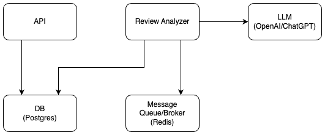

# Amazon Product Intelligence

## Introduction

This project is designed to provide comprehensive analysis of customer reviews from Amazon product listings. Using Large Language Models (LLMs), the system extracts sentiment and actionable insights to facilitate data-driven product development and strategic decision-making.

The core objective is to move beyond basic review aggregation, delivering nuanced understanding of customer feedback. This is achieved through:

- _Sentiment Extraction_: Identifying and quantifying the emotional tone of customer reviews, encompassing positive, negative, and neutral sentiments, as well as specific emotional states (e.g., satisfaction, frustration).
- _Actionable Insight Generation_: Deriving practical, business-relevant insights from review content, including feature-specific feedback, trend identification, and potential product improvement recommendations.

## System Design

The system is comprised of 5 components:

1. **Review Analyzer**  
- This component is responsible for for processing raw review data.
- Implements the core data pipeline which consists of 3 stages:
  - Ingestion: Raw data is taken in and do minor cleanup of data.
  - Analysis: Each review is submitted to LLM for analysis and the result is stored in the database.
  - Finalization: Closes the run record.
- Implemented using `Celery` to enable asynchronous and parallel processing of large volume of reviews.
- Currently, the workers run inside the container. However, they should be able to run externally as separate containers or on other hosts, making this highly scaleable